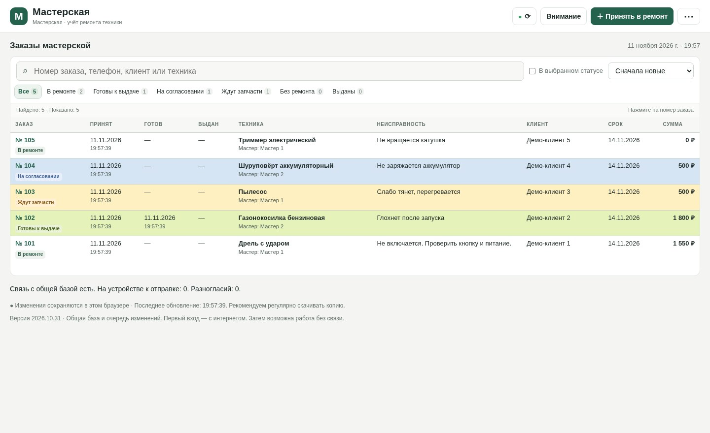
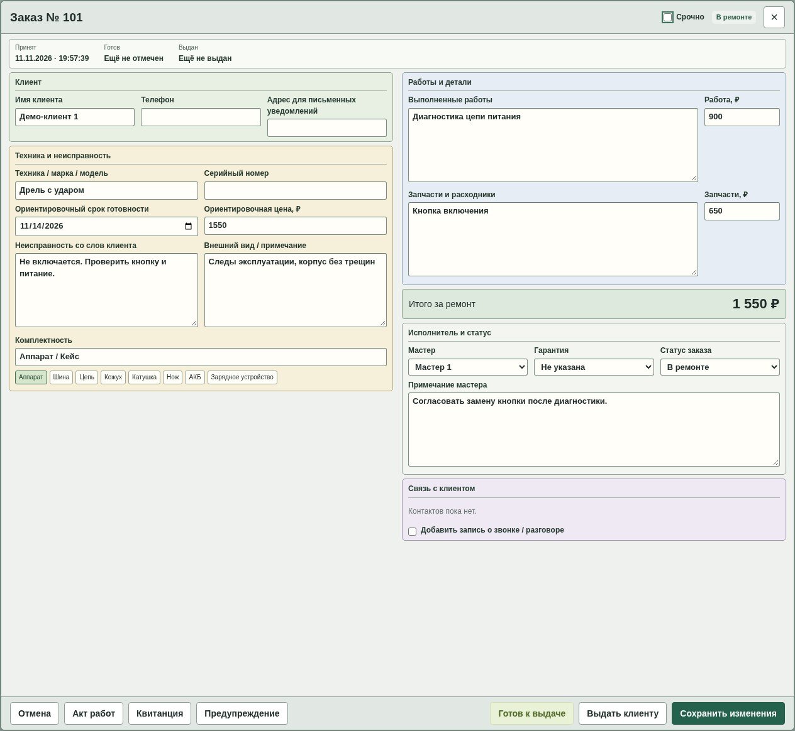
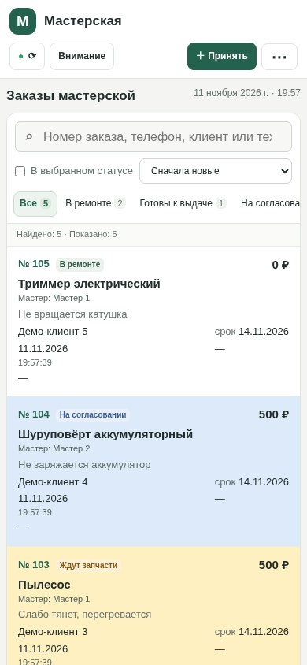

  

<strong>Принимайте технику. Следите за ремонтом. Помните, что уже выдано.</strong>

Программа учёта ремонта для небольшого сервиса — на компьютере и телефоне.

  <a href="docs/USER_GUIDE.md"><strong>Читать понятную инструкцию</strong></a> ·
  <a href="#как-выглядит-программа">Посмотреть скриншоты</a> ·
  <a href="index.html">Файлы лендинга</a>

---

## Когда всё записано — работать проще

Кто принёс технику? Что нужно починить? Клиент уже забрал заказ или только обещал приехать? **«Мастерская» собирает ответы в одном журнале**, чтобы не искать их в тетрадях и переписках.

Подходит для электроинструмента, садовой и бытовой техники и другого оборудования. В карточке можно указать любую модель и неисправность. Это журнал ремонтов; полноценный склад, бухгалтерия и касса пока не предусмотрены.

| Задача | Как помогает программа |
| --- | --- |
| Принять технику | Клиент, телефон, модель, неисправность и комплектность — в одной карточке. |
| Найти заказ | Поиск по номеру, клиенту, телефону или технике. |
| Понять, что происходит | Статусы ремонта, ожидания запчастей, согласования, готовности и выдачи. |
| Посчитать ремонт | Работы, детали и суммы с общим итогом по заказу. |
| Вовремя позвонить | Список залежавшейся техники, записи о звонках и следующем контакте. |
| Закончить работу | Печать квитанции и акта, отметка выдачи и история заказа. |

## Как выглядит программа

### Журнал: все заказы перед глазами

### Карточка ремонта и работа с телефона

<table>
  <tr>
    <th>Всё о ремонте — в одном месте</th>
    <th>Тот же журнал на телефоне</th>
  </tr>
  <tr>
    <td width="68%" align="center"></td>
    <td width="32%" align="center"></td>
  </tr>
</table>

*Это скриншоты настоящего интерфейса v5. Все заказы и клиенты на них вымышлены. Нажмите на картинку, чтобы рассмотреть её крупнее.*

## Один мастер или вся команда

| На одном устройстве | На нескольких устройствах |
| --- | --- |
| Локальная версия открывается файлом в браузере. | Онлайн-версия открывается по адресу сайта. |
| Работает без сервера и интернета. | Общая база позволяет продолжить заказ с другого устройства. |
| Записи хранятся в профиле этого браузера. | У владельца и мастеров отдельные входы и права. |
| Для переноса нужна резервная копия. | После подготовки устройства изменения можно сохранять без связи и отправлять позже. |

В онлайн-версии мастер видит и меняет все заказы своей мастерской. Настройки, импорт, удаление и управление доступом остаются владельцу. Для другой мастерской нужна отдельная база.

> Первый онлайн-вход требует интернета. Офлайн-доступ действует до 7 дней после последней проверки. Временный номер заказа может измениться после синхронизации — это важно, если пишете номер на технике.

## С чего начать

1. **Познакомьтесь с программой:** посмотрите скриншоты и [инструкцию простыми словами](docs/USER_GUIDE.md).
2. **Выберите вариант:** одно устройство или общая онлайн-база.
3. **Потренируйтесь:** проведите несколько тестовых заказов от приёма до выдачи, затем проверьте резервную копию.

**Статус проекта:** здесь опубликованы описание, скриншоты и инструкция. Публичный выпуск самой программы готовится; лицензия и условия распространения ещё не выбраны. Заказов и настроек действующей мастерской здесь нет.

Лендинг — [index.html](index.html), инструкция — [guide.html](guide.html). Для размещения не нужны Supabase, пароли и сборка. Порядок публикации: [PUBLISH.md](PUBLISH.md).
