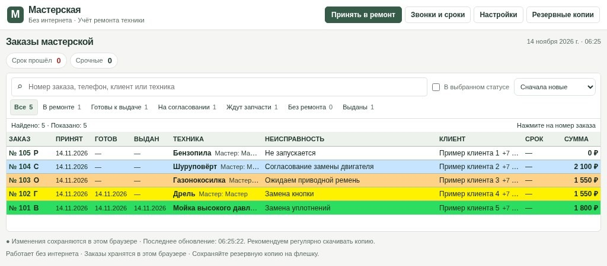

Программа для учёта техники и ремонтов на одном компьютере. Без интернета, регистрации и сервера.

**[Скачать программу](https://vanssk8hai.github.io/service-workshop-site/downloads/workshop-offline.zip)** · [Открыть сайт](https://vanssk8hai.github.io/service-workshop-site/) · [Инструкция](https://vanssk8hai.github.io/service-workshop-site/guide.html)

- Приём, ремонт и выдача техники в одном журнале.
- Клиенты, мастера, работы, детали и стоимость.
- Поиск, статусы, печать акта и резервные копии.
- Данные хранятся в браузере на этом компьютере.

**Как запустить.** Скачайте архив, распакуйте в постоянную папку и откройте «Мастерская-офлайн.html» в Chrome или Edge. Для Windows 7/8 нужен браузер версии 109.

На снимке демонстрационные данные. Лицензия пока не выбрана.
