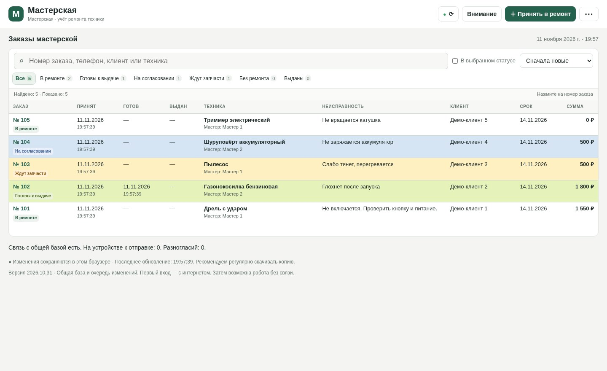
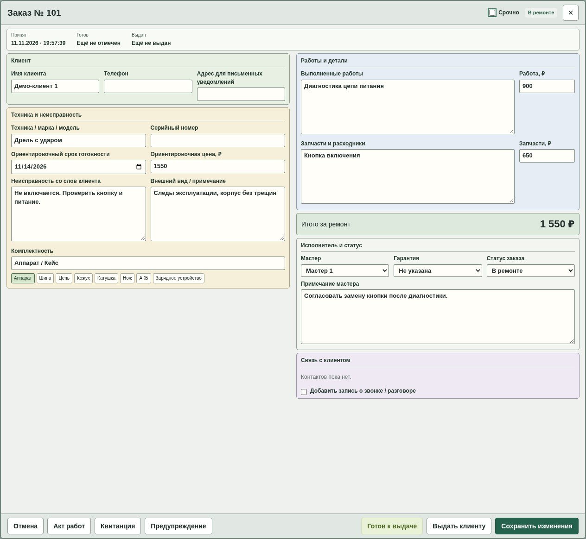

# Мастерская: инструкция простыми словами

Программа помогает записать, кто принёс технику, что нужно починить и забрал ли её клиент. Подходит для небольших сервисов: электроинструмент, садовая и бытовая техника, другое оборудование. Это журнал ремонта, а не полноценная бухгалтерия или складская система.

## С чего начать

**На одном компьютере:** локальная версия открывается файлом в Chrome или Edge. При первом запуске создайте владельца, задайте пароль и сохраните код восстановления отдельно от компьютера. Записи останутся в этом браузере.

**На нескольких устройствах:** онлайн-версию открывают по адресу сайта и входят со своей почтой и паролем. Для неё предварительно настраивают отдельную общую базу мастерской. Если с настройкой сложно, попросите помочь того, кто подключает программу.

Публичный выпуск пока готовится: лицензия и условия распространения ещё не выбраны, открытой ссылки для скачивания программы пока нет.

В онлайн-версии кнопки настроек и резервных копий находятся в **меню ⋯** сверху. В локальной версии они расположены прямо в шапке. В настройках заполните название, контакты мастерской и мастеров. До переноса рабочих данных потренируйтесь на нескольких тестовых записях.

## Как выглядит программа

Все заказы на изображении вымышлены. В онлайн-версии статусы помогают отличать ремонт, ожидание деталей и готовность.

## 1. Принять технику

1. Нажмите **«Принять в ремонт»**.
2. Введите модель, имя и телефон клиента.
3. Опишите неисправность и комплектность: что клиент оставил вместе с техникой.
4. Если знаете — укажите срок и ориентировочную цену.
5. Нажмите **«Сохранить»** или сохранение с печатью квитанции.

**Номер на бирке:** у онлайн-заказа без интернета сначала временный номер, который может измениться после синхронизации. Постоянный номер пишите после успешной синхронизации. Пока связи нет, используйте отдельную временную бирку и сверьте её позже.

## 2. Найти заказ и записать ремонт

В поиске введите номер, телефон, имя клиента или модель. Откройте карточку нажатием на номер заказа. Запишите мастера, работы, запчасти и суммы, затем сохраните.

| Статус | Что он означает |
| --- | --- |
| В ремонте | Идёт диагностика или ремонт. |
| На согласовании | Нужно решение клиента. |
| Ждут запчасти | Нужны детали для продолжения. |
| Готовы к выдаче | Всё готово, техника ещё в мастерской. |
| Без ремонта | Ремонт не выполнен. Передачу клиенту отмечают отдельно. |
| Выданы | Клиент забрал технику. |

В списке «Внимание» / «Залежавшаяся техника» можно найти давно открытые заказы. В карточке записывайте результат звонка и следующий контакт.

## 3. Отметить готовность и выдачу

1. По окончании работы проверьте суммы и отметьте готовность.
2. Свяжитесь с клиентом.
3. Когда клиент действительно заберёт технику, откройте заказ и отметьте выдачу.
4. При необходимости напечатайте акт выполненных работ.

Выданные заказы остаются в истории. Не удаляйте их только потому, что ремонт завершён.

## 4. Если пропал интернет

В локальной версии продолжайте работу. В онлайн-версии заранее войдите на каждом устройстве при наличии сети и проверьте, что программа открывается без неё. После первоначальной подготовки заказы можно принимать и менять без связи.

Когда сеть вернётся, откройте программу и нажмите **⟳ «Синхронизировать»**. Дождитесь **«К отправке: 0»** и **«Разногласий: 0»**. Затем проверьте заказ на другом устройстве.

Первый вход требует интернета. Офлайн-доступ действует до 7 дней после последней проверки. Отправка из закрытой программы не гарантируется. Не очищайте данные браузера с неотправленной очередью и используйте один и тот же адрес программы на всех устройствах.

Если два человека изменили один заказ, появятся разногласия. Сохраните оба варианта и сравните их перед выбором нужного.

## 5. Сохранить резервную копию

1. В онлайн-версии сначала завершите синхронизацию.
2. Откройте **«Резервные копии»** через меню ⋯ или кнопку сверху.
3. Скачайте копию данных — файл **JSON**.
4. Сохраните его отдельно от рабочего устройства, например в закрытой папке на Google Диске.

Файл не нужно редактировать вручную. Сохраняйте несколько копий за разные дни. В копии есть данные клиентов, поэтому доступ к ней должен оставаться у вашей мастерской.

Перед удалением или импортом данных тоже сделайте свежую копию. Перед восстановлением старой копии сохраните текущую базу и внимательно выберите режим импорта.

## 6. Доступ сотрудников

В онлайн-версии владелец управляет заказами, удалением, импортом, настройками и доступом. Мастер видит и меняет все заказы своей мастерской. Каждому нужен свой вход.

Сначала создают учётную запись сотрудника в системе входа. Затем владелец выдаёт доступ по почте через **«Настройки → Сотрудники и права»**. При необходимости попросите помощи с первоначальной настройкой.

Пароль меняют через пункт с именем и ролью в меню. Если забыли — используйте **«Забыли пароль?»** на экране входа. В локальной версии нужен сохранённый код восстановления владельца.

**Для другой мастерской нужна отдельная база.** Если добавить друга владельцем в свою базу, он увидит ваши заказы. Это не создаёт отдельный сервис.

## Если что-то не получается

- **Заказ не находится:** очистите поиск, выберите вкладку «Все», проверьте синхронизацию и учётную запись.
- **На устройствах разные записи:** проверьте адрес сайта и выполните синхронизацию на обоих устройствах.
- **Сайт не открывается:** проверьте связь и сохранённый адрес. Не начинайте с очистки браузера, если есть неотправленные изменения.
- **Удалили нужный заказ:** найдите скачанную перед удалением копию. Сначала сохраните текущую базу, затем проверьте режим восстановления.

Описание и иллюстративный пример — на [главной странице](../index.html). Печатная инструкция — в [guide.html](../guide.html).
